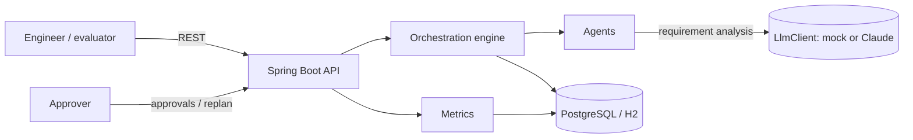
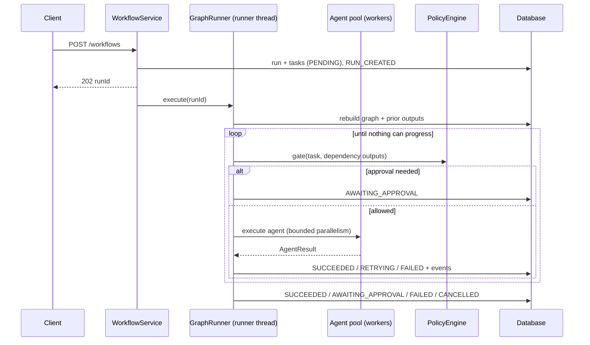
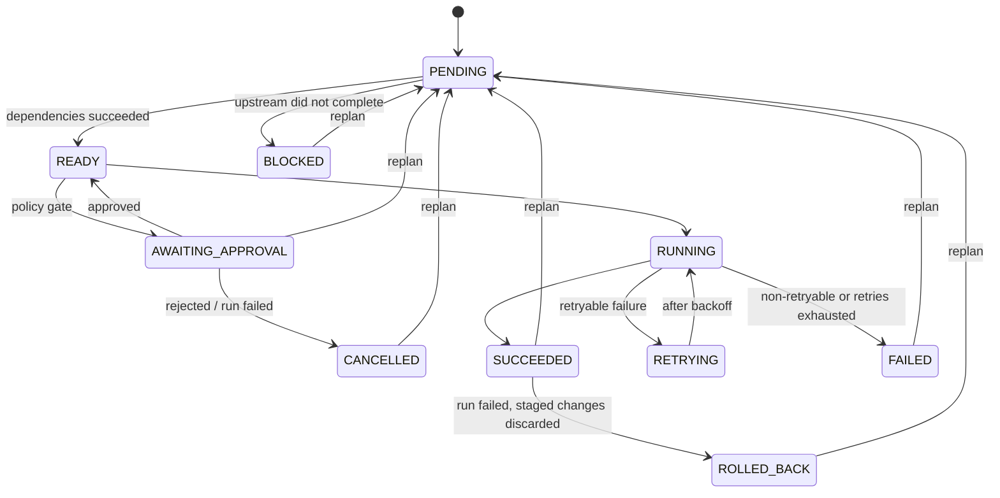

# Architecture

## Goals

1. Turn a natural-language requirement into a validated dependency graph of engineering tasks and execute it with specialised agents.
2. Keep every decision that matters (ordering, permissions, approvals, retries, rollback, completion) **deterministic and testable**. Models recommend; the engine decides.
3. Make every run observable while it executes and explainable afterwards.
4. Run anywhere with no credentials (deterministic mock model), and switch to a real model with configuration only.

## System context

One deployable with clear package boundaries. The workload being "engineered" is the URL shortener in the same repository, which also serves as the brownfield codebase.

## Packages

| Package | Responsibility |
|---|---|
| `orchestration` | `TaskGraph` (DAG + validation), `RunStateMachine` (legal transitions), `GraphRunner` (execution loop), `WorkflowPlanner` (scenario plans), `WorkflowService` (persistence, pause/resume, approvals, replanning), REST API |
| `agent` | `EngineeringAgent` contract, `AgentRegistry`, the eight agents, `FaultInjector` |
| `ai` | `LlmClient` (mock / Anthropic), `RequirementAnalyzer` (prompt + parsing + validation) |
| `governance` | `PolicyEngine` (approval and decision gates), `ApproverPolicy` (who may decide) |
| `execution` | `RetryPolicy` (bounded retries with exponential backoff) |
| `audit` | Append-only `RunEvent` trail, `MetricsService` |
| `shortener` | The demonstration workload: URL shortener with expiry and click analytics |
| `common` | Error mapping (RFC 9457), clock, JSON codec |

## Execution model

Key properties:

- **Validated graph.** `TaskGraph` rejects cycles (Kahn's algorithm), unknown dependencies, duplicates and self-dependencies at construction. Any graph instance is runnable.
- **Legal transitions only.** Every status change goes through `RunStateMachine`; an illegal move throws instead of corrupting state.
- **Single writer.** Only the runner thread mutates the graph and calls the persistence listener. Agents run on a separate bounded pool and return immutable results. There is no shared mutable workflow state across threads.
- **Bounded parallelism.** Independent ready tasks are dispatched concurrently up to `orchestration.max-parallel-tasks`; a finished task immediately unblocks its dependents (no batch barriers). Runner and agent pools are separate, so a runner waiting on agents can never starve them.
- **Immutable context.** Agents receive an `AgentContext` snapshot (requirement, version, completed upstream outputs). They cannot change workflow state.
- **Success means all tasks succeeded.** A run is not successful because agent calls returned; every task must reach `SUCCEEDED`.

## Task lifecycle

## Governance

`PolicyEngine` evaluates each task as it becomes ready, with the outputs of its direct dependencies:

1. **Ambiguity decision gate.** If an upstream task reports `ambiguityCount > 0`, the next task waits for a human. Always in the `AMBIGUOUS` scenario; otherwise unless autonomy is `AUTONOMOUS`. Approve = proceed on recorded assumptions; replan = clarify.
2. **Action gates.** Each agent maps to a governed action (`ANALYSIS`, `DESIGN`, `CODE_MERGE`, `SECURITY_REVIEW`, `TEST_RUN`, `RELEASE`). `MANUAL` gates all, `CONTROLLED` gates the actions in `approvalRequiredFor`, `AUTONOMOUS` gates none.

Approvals require an approver listed in `orchestration.approvers` (403 otherwise) and are only accepted while the run is `AWAITING_APPROVAL` and the task is waiting (409 otherwise).

## Pause, resume and replanning

- When nothing can progress and approvals are pending, the runner returns `AWAITING_APPROVAL` and its thread exits. The run is fully described by the database.
- An approval or replan takes a per-run lock, updates the database, sets the run to `RUNNING` and starts a new runner, which **rebuilds the graph and prior outputs from persisted state**. Paused runs therefore survive a restart.
- Replanning increments the requirement version and resets to `PENDING` only the changed task (default: the first), everything downstream of it, and any task that did not complete. Upstream results are kept. Every reset is validated through the state machine before the database is touched.

## Failure handling

| Situation | Behaviour |
|---|---|
| Transient agent failure (`TIMEOUT`, `LLM_UNAVAILABLE`, injected) | `RETRYING` with exponential backoff, up to `max-retries` |
| Non-retryable (`VALIDATION_FAILED`, `POLICY_DENIED`, `IMPACT_UNKNOWN`, `NULL_RESULT`) | `FAILED` on first attempt |
| Agent throws | Contained as `AGENT_EXCEPTION`, treated as a failure |
| Run fails or is cancelled | Pending tasks `BLOCKED`, open approvals `CANCELLED`, succeeded tasks with `staging/` artifacts `ROLLED_BACK` |
| Engine error | Run marked `FAILED` with the error recorded in the audit trail |

## AI integration

`RequirementAgent` calls `RequirementAnalyzer`, which owns the prompt, calls `LlmClient`, parses `CRITERION / AMBIGUITY / ASSUMPTION` lines and rejects replies without criteria. The model influences **content** (criteria, ambiguities, assumptions); it never controls **flow**. Whether ambiguities block the run is a policy decision.

`ai.provider=mock` (default) uses `MockLlmClient`, deterministic and rule-based, emitting the same format a real model is asked for, so the parsing and gating code paths are identical in CI. `ai.provider=anthropic` uses `AnthropicLlmClient` (Claude Messages API via Spring `RestClient`).

Spring AI was considered; its Boot 4 compatible line is new, so the adapter is built on Spring's own HTTP client behind the `LlmClient` interface. Swapping in Spring AI later is a single new implementation.

## Data model

| Table | Purpose |
|---|---|
| `workflow_run` | Scenario, requirement and version, autonomy, approval scope, status, timestamps |
| `task_execution` | Per-task status, attempts, dependencies, outputs (JSON), artifacts, error, timing |
| `run_event` | Append-only audit: run lifecycle, every task transition with reason, every agent result, approvals, replans |
| `short_url`, `click_event` | The shortener workload |

Flyway owns the schema (`V1`–`V3`); Hibernate only validates it.

## Deliberate trade-offs

- **One deployable, not microservices.** Package boundaries give separation without distributed-systems cost for a single workload.
- **In-process runner, per-run JVM lock.** Correct for a single instance. Horizontal scaling would need a database lease or row lock per run (e.g. `SELECT ... FOR UPDATE SKIP LOCKED`) and a queue for runner hand-off.
- **Deterministic agents.** Apart from requirement analysis, agents simulate engineering work with structured, reproducible outputs rather than editing code, so behaviour is testable and demos are repeatable.
- **Metrics computed on demand.** Fine at this scale; production would export to Prometheus via Micrometer.
